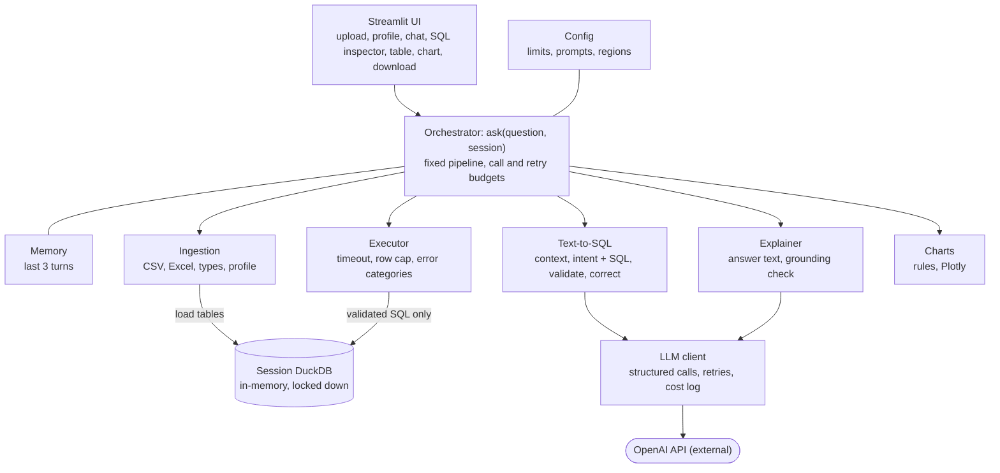
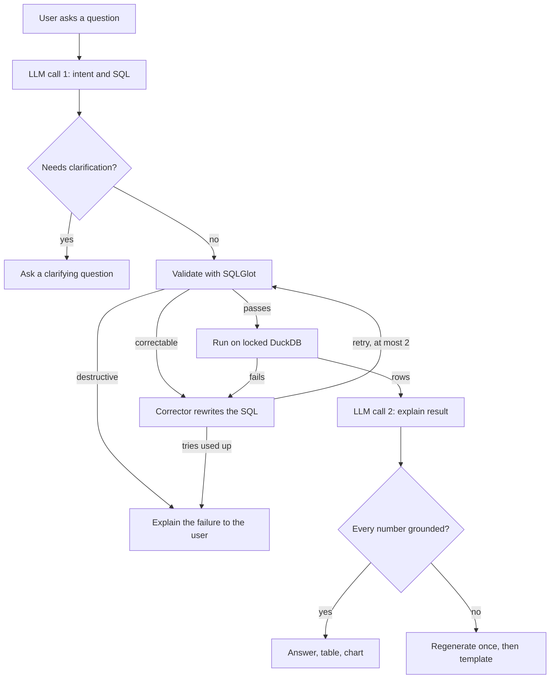

# Architecture

- Version: 1.0 (MVP design)
- Date: 2026-11-22
- Related: [PRD](prd.md), [security](security.md), [privacy](privacy.md), [ADRs](adr/README.md)

## 1. Overview

The MVP is one Python 3.12 process. A thin Streamlit UI keeps one `AnalystSession` per browser session and calls `session.ask(question)`, which applies the rate limit and runs the pipeline's `Analyst.ask`, a fixed pipeline that returns everything the UI shows. Only the executor runs SQL, and only the LLM client talks to OpenAI. Nothing outside `analyst/ui/` and `app.py` imports Streamlit (ADR 0001); a test enforces it.



## 2. Components

| Component | Module | Responsibility | Depends on |
| --- | --- | --- | --- |
| UI | `app.py`, `analyst/ui/` | Draws the page and passes on what the user did: password gate, upload and read options, preview, profile and quality tabs, chat, progress line, results, SQL inspector, CSV download, new conversation and replace, privacy notice and schema-only switch. No state of its own, no SQL, no model calls | Session |
| Session | `analyst/session/` | One browser session's state (`AnalystSession`): loads a file (`dataset.py`), applies the rate limit (`limiter.py`), keeps the conversation (`state.py`), forgets idle data (`eviction.py`), and turns profiles, results and filters into text and tables the page can show (`display.py`). No Streamlit, so it is tested without a browser | Orchestrator, ingestion, session store |
| Orchestrator | `analyst/pipeline/analyst.py` | Runs the pipeline, enforces budgets, maps errors to messages, records turns | All pipeline components |
| CSV loader | `analyst/ingestion/csv_loader.py` | Size check, encoding and delimiter detection, parse as text | `normalize.py` |
| Excel loader | `analyst/ingestion/excel_loader.py` | Zip-bomb check, sheet list, header detection, parse with calamine | `normalize.py` |
| Normaliser | `analyst/ingestion/normalize.py` | Type inference, day-first dates, numeric text, censored values, identifier mapping | Domain config |
| Profiler | `analyst/ingestion/profiler.py`, `schema_card.py` | Profile and quality summary computed in DuckDB; schema card text fitted to a token budget (pure function of the profile) | Session store |
| Session store | `analyst/database/session_db.py` | Per-session DuckDB, table load, lockdown, catalog, idle eviction | DuckDB |
| Executor | `analyst/database/executor.py` | Run validated SQL with timeout and row cap; classify errors | Session store |
| Context builder | `analyst/sql/context.py` | Adds sample rows, region rules and the untrusted-data block around the schema card | Profiler output |
| Generator | `analyst/pipeline/generator.py` | One structured call: intent, then SQL or clarification (ADR 0006) | LLM client, context |
| Validator | `analyst/sql/validator.py` | SQLGlot AST checks (ADR 0005) | Catalog |
| Corrector | `analyst/pipeline/corrector.py` | One repair call on the generator's conversation, with the validator's reason or the database's message | LLM client, context |
| Query loop | `analyst/pipeline/query_loop.py` | Validate, run and correct within the limits: 2 corrections, a heavy query once, one call kept for the explainer | Validator, executor, corrector |
| Explainer | `analyst/pipeline/explainer.py` | Plain-language answer with key numbers | LLM client |
| Grounding check | `analyst/pipeline/grounding.py` | Match every number in the answer to the result (ADR 0017) | None |
| Chart recommender | `analyst/visualization/recommender.py` | Choose chart type from result shape and intent | None |
| Chart builder | `analyst/visualization/charts.py` | Build Plotly figures | Plotly |
| Memory | `analyst/memory/conversation.py` | Turns, window of 3, carried assumptions, reset | None |
| LLM client | `analyst/llm/client.py`, `fake.py` | OpenAI structured outputs, retries, timeouts, cost (ADR 0004) | OpenAI SDK |
| Config | `analyst/config/` | Settings and limits (ADR 0014), prompts, region rules (ADR 0009) | pydantic-settings |

## 3. Session model

Each browser session holds one `AnalystSession` (`analyst/session/state.py`) in `st.session_state`, created on its first run. It is never shared and never in a module global, `st.cache_data` or `st.cache_resource`; tests scan the source for all three.

- `db`: the session's DuckDB connection (ADR 0002), which also keeps the time of the last activity
- `dataset`: what the page shows about the loaded file: the profile, the quality notes, how the file was read (separator, header row, sheet) and a 50-row preview. Built once at load, so a rerun queries nothing
- `memory` and `history`: the model's last three turns, and the questions and answers the page shows (`ChatEntry`), which also hold the result's CSV once it has been asked for
- `limiter`: question timestamps, a sliding window of 20 questions in 10 minutes (FR-10.2). Loading another file, a new conversation, and the data being removed for idleness do not reset it
- `schema_only`: the switch the user chose; applied to the next question, and carried over to the next dataset
- `expired`: true after the data was removed for idleness, until a file is loaded again

`load` and `ask` do not raise for a failure of the file or the question. A file that cannot be loaded is a `LoadFailure` with a message; a question that cannot run (today, over the rate limit) is a `ChatEntry` with a notice instead of a response. Loading reads and types the file before the database is touched, so a file that cannot be read leaves the dataset already loaded as it was.

**Idle data.** The session's data is removed after 60 minutes without activity in two ways: when the user comes back (`expire_if_idle`, before the visit counts as activity), and by a sweeper thread for tabs that are left open. The sweeper reads a registry of weak references, so it keeps no session alive, and it holds no data of its own. It is the one thread the app starts, and the only module-level state that points at sessions.

### The interface

`analyst/ui/app.py` draws the page on every run, in this order, so that what a click changes is already changed when it is drawn: password gate, session, idle check, the sidebar's file section (which acts on an upload or a confirmation, and may rerun), the title and notices, the question box, then, with a dataset, the data panel and the conversation, and last the sidebar's privacy and conversation controls. The question box is drawn first because Streamlit pins it to the bottom of the page whatever the call order.

- **Loading a file** is explicit: choosing a file *stages* it and offers how to read it (sheet, separator, header row, with detection as the default) beside a *Load file* button. Replacing a dataset asks first when there is a conversation, because it clears it. After a successful load the uploaded bytes are deleted from Streamlit's own memory (`remove_file` on the run's upload manager) and the uploader is emptied, so the table is the only copy. If Streamlit's release fails, the copy stays until the session ends and the failure is logged by type.
- **Progress** is shown while a question runs: the orchestrator tells an optional callback when each of its three slow stages begins (understanding, running, explaining), and the page shows one line for it. A failing callback never fails the question.
- **Text from outside is never markup.** Everything that came from the file, the user or the model is shown through `escape_markdown` (every ASCII punctuation mark escaped, and a zero-width space inside web and email addresses, which Streamlit would otherwise link even when escaped), except the model's explanation, which has already had links, images and addresses removed (`sanitize_text`) and is shown with only `$` escaped. No call uses `unsafe_allow_html`. Tables are made of text, so Arrow never sees a mixed column.
- **A download is safe to open in a spreadsheet:** a text cell or heading that starts with `=`, `+`, `-`, `@`, a tab or a carriage return gets a leading apostrophe. Numbers are not touched.
- **Charts** are drawn with `theme=None`, so Streamlit does not replace the validated colours, once for light and once for dark.

## 4. Data contracts

All stages exchange Pydantic models defined in `analyst/core/models.py`. Models sent to OpenAI as structured-output schemas (marked LLM) are kept compatible with OpenAI's strict JSON schema mode, which a unit test enforces.

| Model | Kind | Key fields |
| --- | --- | --- |
| `ColumnSchema` | Internal | `sql_name`, `display_name`, `dtype`, `flags` (ambiguous_date, censored_values, mixed_types, numeric_text, all_missing, constant) |
| `ColumnProfile` | Internal | `ColumnSchema` plus `null_count`, `distinct_count`, `min_value`, `max_value`, `mean`, `std`, quartiles, `top_values`, `date_min`, `date_max` |
| `DatasetProfile` | Internal | `table_name`, `source_name`, `sheet_name`, `row_count`, `column_count`, `columns`, `duplicate_rows`, `primary_date_column`, `latest_date` |
| `QualityIssue` | Internal | `kind` (duplicate_rows, all_missing, mixed_types, censored_values, ambiguous_date, missing_values, constant), `column`, `count`, `message` |
| `Intent` | LLM | `operation`, `measures`, `dimensions`, `filters`, `time_range`, `sort`, `limit`, `output` |
| `GenerationResult` | LLM | `resolved_question`, `ambiguities`, `needs_clarification`, `clarification_question`, `intent`, `assumptions`, `sql`, `explanation`, `chart` |
| `ModelExplanation` | LLM | `answer_markdown`, `key_numbers` (value, column, label), `caveats` |
| `ValidationResult` | Internal | `status` (ok, correctable, rejected), `category`, `reason`, `safe_sql` |
| `QueryResult` | Internal | `dataframe`, `row_count`, `truncated`, `duration_ms`; successful queries only |
| `ResultSummary` | Internal | `columns`, `row_count`, `truncated`, up to 20 preview rows |
| `Turn` | Internal | `question`, `status`, `resolved_question`, `intent`, `sql`, `assumptions`, `answer_text`, `result_summary` |
| `Usage` | Internal | `llm_calls`, `input_tokens`, `output_tokens`, `cost_usd`, `latency_ms` |
| `AnalystResponse` | Internal | `status` (answered, clarification, failed), `message`, `resolved_question`, `assumptions`, `caveats`, `sql`, `result`, `chart`, `grounded`, `fallback_used`, `usage`, `turn` |

Failures are raised as typed errors from `analyst/core/errors.py`, each with a `category` for logs and a `user_message` safe to show: `IngestionError`, `QueryExecutionError`, `LLMError`, `BudgetExceededError`, `RateLimitedError`, `SessionCorruptedError`. The orchestrator turns them into a `failed` response.

## 5. Dataset loading flow

1. UI stages the uploaded file; extension is checked by the uploader and size by the loader.
2. Excel: the zip's uncompressed size is checked, sheets are listed, the user picks one (visible sheets first).
3. Loader parses to a dataframe of strings, detecting encoding, delimiter and header row.
4. Normaliser infers types (day-first dates by region), flags ambiguous dates and censored values, and maps names to identifiers.
5. Session store loads the dataframe with `CREATE TABLE ... AS`, then applies the lockdown settings.
6. Profiler computes the profile and quality summary in SQL; context builder renders the schema card.
7. UI shows preview, profile and quality summary; the conversation starts empty.

`load_dataset` (`analyst/session/dataset.py`) is the one place that knows the order of steps 3 to 6. Steps 3 and 4 happen before the session's database is touched. A failure after step 5 closes the database, so no table is left that was not profiled.

Uploaded bytes are never written to disk, and after a successful load the UI deletes Streamlit's copy of them (section 3).

## 6. Question flow



Budgets per question: 2 correction attempts and 5 LLM calls in total, with one call always kept for the explanation.

### The orchestrator

`Analyst` (`analyst/pipeline/analyst.py`) is created once per loaded dataset, with the session's database, the dataset profile, the model client and the session's `ConversationMemory`. `Analyst.ask(question, on_progress=None)` returns an `AnalystResponse` and does not raise for a failure of the question. `on_progress` is called with `understanding` before the first model call, `running` before the query loop and `explaining` before the explanation, each only when it is reached (a clarification only says `understanding`); an exception in it is logged by type and ignored. In order:

1. **The question** is cleaned (`clean_question`: printable text, stripped, 1 to 2,000 characters). A question that is empty or too long is a `failed` response with no model call, no activity on the session and no turn in memory.
2. **Generate.** The generator is given the question, the profile, three sample rows (read from the table once, none in schema-only mode), the memory's last three turns, and the assumptions carried from earlier answered turns, which the `HISTORY` block lists before the turns (`ContextBuilder.generation_context(carried_assumptions=...)`) so an assumption outlives its turn leaving the window (ADR 0011). The window the model is shown and the window memory keeps are one constant (`WINDOW_TURNS`).
3. **By kind.** `clarification` is returned as a `clarification` response and nothing runs. `refused` is a `failed` response carrying the model's explanation (benchmark case I02). `sql` goes on.
4. **Run.** `QueryLoop.run` (section 7) with the question's `CallBudget`. Any status but `ok` is a `failed` response whose message is the loop's; its `sql` is the last query tried, so the user can see what was refused or could not be fixed, and the turn keeps none, so a follow-up is not built on it.
5. **Explain and chart.** The explainer gets the corrected answer's restatement, intent, SQL and assumptions. The chart is the model's suggestion if it fits the result, else by rule (`recommend_chart`); a failure there costs only the chart. The response carries the explanation (`message`, `caveats`, `fallback_used`), `grounded` true (each number was checked against the result or written by code from it), the result and the chart.
6. **Record** the turn (every response but a bad question): question, restatement, intent, and, when answered, the SQL, assumptions, answer text and a summary of the result. Clarification and failed turns carry no assumptions, so nothing unsettled carries forward.

One `ContextBuilder` per `Analyst` is shared by the generator, the corrector and the explainer, so one marker code covers every prompt of the session and two sessions never share one. `schema_only` is an attribute the interface may change between questions.

**Errors.** Every typed error becomes a `failed` response with its `user_message`: `LLMError` (its `usage` is still counted), `BudgetExceededError`, `SessionCorruptedError`. Any other exception is a bug: the user sees "Something went wrong. Please try again.", the log carries the exception's type and not its message, and the turn is recorded as failed. `RateLimitedError` belongs to the interface (FR-10.2).

**Usage.** `AnalystResponse.usage` adds up every call that reached the model, including unusable ones. Its `latency_ms` is the wall-clock time of the whole question, because ADR 0013 measures p95 question latency, not the sum of the model calls.

**Logs.** One `question` line: status, kind, run status, corrections, attempts, explanation source and fallback reason, chart type, row count, truncation, schema-only flag, call count, tokens, cost and latency. Never the question, the SQL or any text from the model.

## 7. Text-to-SQL details

### Context (code only)

`ContextBuilder` (`analyst/sql/context.py`) builds the intent-and-SQL call from two parts. The **system prompt** (`analyst/config/prompts.py`) is fixed text for a session: how to fill each field, the SQL rules, the region's date order and seasons (ADR 0009), how relative dates are anchored, when to ask (ADR 0011), the list of functions the validator allows, and the instruction that marked blocks are data. The **user message** has three marked blocks, in this order so the provider can cache the stable start:

- `DATASET`: the schema card, then three sample rows. The card lists, per column: SQL name, original name, type, null percentage, distinct count, min and max, date range, and up to 20 most frequent values for text columns with 50 or fewer distinct values. Target size: under 3,000 tokens. The dataset's latest date is on the card's first lines.
- `HISTORY` (omitted on the first turn): the last three turns (question, resolved question, intent, assumptions, SQL, and the clarifying question when the turn was one), then the shape of the most recent result and its first five rows.
- `QUESTION`: the user's question, at most 2,000 characters.

Schema-only mode (ADR 0010) leaves out the sample rows, the frequent values and the result preview. Cell text is cut to 80 characters and flattened to one line, and the marker lines carry a random code chosen when the builder is created, so text from the file cannot close a block (security.md, section 3). The builder returns an estimate of the prompt's tokens (3 characters per token); the generator logs it next to the real count so the estimate can be checked.

### Generation (LLM call 1)

Returns `GenerationResult` with fields in the order shown in section 4, so intent precedes SQL. `Generator.generate` (`analyst/pipeline/generator.py`) makes the call and decides what the answer is, in code:

| `Generation.kind` | When | Then |
| --- | --- | --- |
| `sql` | The model gave SQL and did not need to ask | Validate and run it |
| `clarification` | `needs_clarification` with a question, and at least one ambiguity has `changes_result` true | Ask the user the question; nothing runs |
| `refused` | No SQL, no question, and an explanation: the request was to change data, read files or ignore the rules (benchmark case I02) | Answer `failed` with the model's explanation; nothing runs |

- **The clarification gate** (ADR 0011) is in code. If the model asks but none of its ambiguities would change the result: with SQL, the SQL runs and `clarification_overridden` is set; without SQL, the model is told once to take the most likely reading and write the SQL. If it asks again the question is passed on rather than failing the user.
- **Unusable answers.** An inconsistent answer (asks but gives no question, or gives no SQL, question or explanation) and an `invalid_output` error are each asked for again once. A second failure raises `LLMError("invalid_output")` carrying the cost of both calls. Other errors (timeout, rate limit, API error, not configured) are raised at once, and a spent budget raises `BudgetExceededError` before any call. There is no template fallback here: a question that was never understood has nothing to show.
- **Intent columns.** `Generation.unknown_columns` lists every intent column that is not a column of the table (SQL names, any capitalisation), with up to three closest real names (matched against SQL names and the original headers). `intent_problem` words it for the corrector. The orchestrator sends it to correction before validation, as an unknown-column error.
- **Text for the user** (restatement, assumptions, ambiguities, clarifying question, explanation) is cleaned with `sanitize_text` (`analyst/pipeline/safe_text.py`: links reduced to text, images to alt text, addresses removed). The clarifying question and the refusal are also flattened and cut to 600 characters. The SQL is not touched; the validator judges it.
- **Hand-off.** `Generation.opening` holds the system and user messages that were sent, so the corrector can continue the same conversation. `approx_tokens` is the builder's estimate, logged next to the real `input_tokens` so the 3-characters-per-token rule can be checked once there is a key.

### Validation (code only)

Rules are listed in [security.md](security.md#sql-validator-rules).

### Correction (LLM, bounded)

`QueryLoop.run` (`analyst/pipeline/query_loop.py`) takes the generator's answer and returns a result or the reason there is none. `Corrector.correct` (`analyst/pipeline/corrector.py`) makes the one call inside it. What is retried is decided by what the validator and the executor said:

| Problem | Retried | Corrector receives |
| --- | --- | --- |
| Validator `correctable`: unknown table or column | Yes | The validator's reason: the name the model wrote and the closest real names |
| Validator `correctable`: function not on the allowlist | Yes | The function, and the nearest allowed name when one is close |
| Validator `correctable`: unsupported syntax, too complex | Yes | What syntax, or which limit |
| The intent names columns that are not in the table | Yes, once, and softly (below) | The names, with the closest real ones |
| Execution error, type mismatch (`binder`, `conversion`) | Yes | The database's message, and the types of the columns the query uses |
| Other execution error | Yes | The database's message, cleaned |
| Timeout or out of memory | Once, for both together | A request for a simpler query |
| Validator `rejected`: changes data, reads files or the environment, path-like table, several statements, syntax error (V12) | No | Not sent; the turn ends with a safety message |

Whether a query is correctable is the validator's `status`, not its category, so the table follows security.md section 4. The earlier version of this table listed a parse error as retried, but rule V12 rejects it; if V12 is relaxed after real traffic is measured, nothing in the loop changes (`parse_error` already has its request).

- **The call.** The model is shown the conversation the generator started (`Generation.opening`), then its own answer again, then a `PROBLEM` block and a one-line request that depends on the category (`analyst/config/prompts.py`). It answers in the same format as call 1 (`GenerationResult`), so a correction can change the intent and the assumptions as well as the SQL, and the corrected answer is the one the explainer and memory use. A second correction continues the same conversation. Every correction goes back through the validator.
- **What the block holds.** The validator's reason names only identifiers the model wrote, cut to 40 characters, and never a value. The database's message can quote values and names from the file, so it is flattened, cut to 400 characters and placed in the `PROBLEM` block, which is fenced like the rest of the file's text (security.md section 3). In schema-only mode (ADR 0010) quoted text is removed from it, and for the categories that can echo a cell (`conversion`, `other`) the message is withheld and only the title and the column types are sent.
- **Limits** (FR-4.4). At most `MAX_CORRECTIONS` corrections per question (2), counting a correction whose answer was unusable; a timeout or out-of-memory failure is corrected once whatever else happened, because a second try only makes the user wait for the same failure; and a call is always left in the question's budget for the explainer (`reserve_calls`, 1), so correcting cannot leave the answer without an explanation.
- **The intent check is soft.** `Generation.unknown_columns` is sent to the corrector first, before validation, and counts as a correction. It is not sent again after that. If it cannot be corrected (no correction or call left, a failed or unusable call) the query is checked as written, because the validator and the database judge the SQL itself, and a mislabelled intent does not make a good query wrong.
- **How it ends** (`RunOutcome.status`). `ok` (the rows are in `result`); `rejected` (a safety message); `unfixed` (corrections or the heavy-query allowance used up; the message says what failed when the last failure was a run failure); `budget` (no call to spare); `llm_error` (a correction call failed); `gave_up` (asked to fix the query, the model gave none and said why, and its words, cleaned, are the message). Every message is written from the category and never from the SQL, the validator's reason or the database's message, except `gave_up`, which is the model's own cleaned explanation. The outcome also carries every attempt (query, stage, category), the number of corrections, and the cost of the correction calls, including calls that reached the model and gave an unusable answer.
- **Logs.** One line per attempt (stage, category, a hash of the SQL) and one per run (status, attempts, corrections, last category), and one per correction call. No SQL, no database message and no model text.

An empty result is not an error. The answer says so and lists the filter values used.

### Execution (code only)

The validator wraps its checked SQL as `SELECT * FROM (...) LIMIT cap + 1` and records the cap in the `ValidationResult`. The executor runs only that text: it confirms on the session connection that it is exactly one `SELECT`, runs it with a timer thread that calls `connection.interrupt()` at the timeout, fetches at most cap + 1 rows (the extra row sets `truncated`), verifies the catalog after every query, and logs duration, row count and a SQL hash. The database's own error message goes to the corrector in `QueryExecutionError.engine_message` and is never logged.

### LLM client (every model call)

`LLMClient.complete(stage, messages, response_model, budget=…)` is the only way the pipeline talks to a model (`analyst/llm/client.py`). It calls the OpenAI Responses API with structured outputs, so the caller names a Pydantic model and gets an instance back or an `LLMError`. The stage picks the model: `generate` and `correct` use `LLM_MODEL_GENERATE`, `explain` uses `LLM_MODEL_EXPLAIN`.

- **Configuration.** A missing key or model is `not_configured`, raised before any network call and before the call budget is charged. The key is a `SecretStr` and is never logged.
- **Budget.** A per-question `CallBudget` (`MAX_LLM_CALLS`) is charged once per logical call; retries inside the client do not use extra budget. The call after the last one allowed raises `BudgetExceededError` before anything is sent.
- **Retries.** Connection failures, 429 and 5xx are retried up to `LLM_MAX_RETRIES` times with exponential backoff (1 s base, 8 s cap) and jitter, honouring `Retry-After` up to 20 s; a longer wait fails at once. Other 4xx errors, a timeout, and an exhausted quota (`insufficient_quota`, which retrying cannot fix) are not retried. The SDK's own retries are off so the client is the only place that retries.
- **Privacy.** Every request sends `store=false` (ADR 0010, privacy.md). Prompts and answers are never logged.
- **Unusable answers.** A refusal, a cut-off answer (`incomplete:<reason>`), output that does not fit the model, and a 200 response with nothing in it are `invalid_output`, and are not retried by the client; the stage that knows its budget decides whether to ask again. A 200 whose body is not a Responses payload at all (a proxy error page) is `api_error`.
- **Cost.** Token counts come from the response. Cost is computed from `LLM_PRICES` (a JSON map of model name to `input_per_mtok`, `output_per_mtok` and optional `cached_input_per_mtok`, in dollars per million tokens); a model with no price costs 0 and the log line says `cost_known: false`. A call that reached the model but gave an unusable answer was still billed, so its `LLMError` carries `usage` for the orchestrator to add to the question's total.
- **Logging.** One `llm_call` line per success (stage, model, schema name, tokens including cached and reasoning, cost, latency, attempts, request id), `llm_retry` per retry, and `llm_call_failed` per failure.

`FakeLLMClient` (`analyst/llm/fake.py`) implements the same protocol from a script, so every other stage is tested without the network.

### Explanation and grounding

The explainer receives question, intent, SQL, assumptions and result. The grounding check is described in ADR 0017.

**What the model is shown** (`ContextBuilder.explanation_context`, `analyst/pipeline/result_digest.py`). Three marked blocks: `QUESTION` (the question, and its restatement if different), `ANALYSIS` (intent, assumptions, SQL) and `RESULT`. A result of 50 rows or fewer is shown in full. A longer one shows its first 20 rows and a list of statistics computed in code over all returned rows: for each column the number of values and missing values, and for numbers the minimum, maximum, mean, median and sum, for dates the earliest and latest, for text the number of distinct values and the three most common with their counts. Results are cut to their first 30 columns and the model is told how many were left out. If the query hit the row cap the model is told to say so. The statistics are numbers the model may quote, so they are passed to the grounding check as extra allowed numbers. The marked-block rules are the same as for generation (containment below and in security.md), and the result is sent in schema-only mode too, because the answer must describe it (ADR 0010).

**Explainer flow** (`analyst/pipeline/explainer.py`, `Explainer.explain`):

1. An empty result needs no model call. Code writes the answer and names the filters (`empty_result_answer`).
2. The model returns `ModelExplanation` (answer text, key numbers, caveats). Text from the model is made safe: links are reduced to their text, images are replaced by their alt text, and web and email addresses are removed (see Security below). The cleaned text is what is checked and what is shown.
3. The answer passes if `check_grounding` finds nothing wrong and the text has no spelled-out number from eleven up (`twelve`, `fifty`, `hundred`, `million` not after a digit), because the check cannot read those. Words up to ten are not looked for: they are too common in ordinary sentences, so a made-up "three" is a known gap that the prompt's request for digits narrows.
4. A failed check gets one regeneration. The model is shown its own answer and a sentence naming the numbers that were not accepted (numbers only, never values from the result). An answer that is empty, refused, cut off or does not fit the schema (`invalid_output`) also gets one more try.
5. A second failure, a failed call (timeout, API error, rate limit), or an exhausted call budget gives the template answer from code (`template_answer`) and the table. The question is not failed because the explanation was: the query ran, and its table is the answer. `Explanation.fallback_reason` records why (`ungrounded`, `llm_error`, `budget`, or `empty_result`, which is not counted as a fallback), so the benchmark can report the fallback rate.
6. Notes written by code (truncation, missing values) always come first in `caveats`, followed by the model's, without repeats.

The explainer makes at most two model calls per question, charged to the question's `CallBudget`. T1.17 must leave one call in the budget for it, or a question that needed all its calls for correction gets the template answer.

**Grounding check** (`analyst/pipeline/grounding.py`, pure code). It reads every number out of the explanation's text, caveats and key-number labels, and requires each to match a number the pipeline can vouch for: a value in the result, the result's row and column counts, a number in the question or the assumptions, the year, month and day of a date in the result, a number written inside a text value or column name, or an extra number the pipeline supplies (such as the summary statistics shown for a long result). Each key number must also be a value of the result column it names. A derived figure (a difference, ratio or share) matches nothing unless a query produced it, which is the point.

How a written number is read: `1,234.5`, `$1,234`, `12%`, `12 percent`, `.5`, `1e3`, `1.2 million` and `3k` are understood; a leading minus is ignored, so direction is not checked. A number matches if it is within half a unit of its last written digit of an allowed value (`1,234.57` and `1,235` both match 1234.5678), and `12%` matches 12 or 0.12. Trailing zeros are not treated as rounding, so `1,200` does not match 1,234; this is strict on purpose, and the benchmark's fallback rate will show whether to relax it. Not read: numbers spelled as words, ordinals, digits inside identifiers such as `Q3`, and list numbering. The explainer's prompt must ask for digits.

**Notes written by code** (`analyst/pipeline/result_notes.py`) so they cannot be wrong, and so they need no grounding check: a caveat when the result was cut at the row cap, caveats naming columns with missing values (at most five, then a count of the rest), the answer for an empty result (which lists the filters and date range from the intent), and the template answer used when no explanation passes the check (ADR 0017): "Here is the result of the query", with the single value stated when the result is one number.

## 8. Conversational memory

`ConversationMemory` (`analyst/memory/conversation.py`) is one in-process object per session.

- Each turn stores question, resolved question, intent, SQL, assumptions, answer and a result summary (columns, row count, up to 20 rows). At most 50 turns are kept; the oldest are dropped beyond that.
- `recent()` returns the last three turns. LLM call 1 sees those (question, resolved question, intent, SQL) and only the most recent result summary.
- A new question always runs a new query; the explainer sees only the current result.
- Carried assumptions: the assumptions stated on answered turns are kept for the rest of the session, oldest first, without repeats (a restated one moves to the end), at most the latest eight. A user who sees an assumption and carries on has accepted it; turns that asked for clarification or failed settle nothing and carry nothing. When two carried assumptions conflict, the later one is the one to follow, which is why the order is kept. The orchestrator (T1.17) passes them to the context builder.
- Reset clears turns and carried assumptions. Replacing the dataset does the same, after the interface has asked for confirmation.
- No persistence beyond the browser session in the MVP.

## 9. Charts

Code: `analyst/visualization/` (`recommender.py` chooses, `charts.py` draws, `theme.py` holds the colours).

| Result shape | Chart |
| --- | --- |
| One date or timestamp column plus one or more numeric columns | Line, one line per numeric column |
| One date, one text column (8 or fewer values), one numeric column | Line, one line per text value |
| One text column (30 or fewer values) plus one or more numeric columns | Bar |
| Two numeric columns, no grouping (3 rows or more) | Scatter |
| One numeric column of raw values (10 rows or more) | Histogram |
| Anything else, or a single value | Table only |

The model's chart suggestion (`GenerationResult.chart`) is used only when every column it names exists and suits the chart type. Otherwise the rules above decide. A suggestion of `none` is respected: the model knows whether the user asked for a listing.

**A chart is refused rather than bent to fit.** `fit_problem` returns the reason, which names columns and counts but never values from the data. A chart is refused when several rows share one x position or one category (they would stack on one spot), when a bar chart would have more than 30 bars, when there are more than 8 groups (3 for a scatter plot), when every group has only one point, or when the value columns are not numeric. The result is always shown as a table as well, so a missing chart loses nothing.

**Drawing rules** (from the data-visualisation method used for this project; each one has a test):

| Rule | Detail |
| --- | --- |
| One axis | Value columns whose median sizes differ by more than 10 times get one panel each, stacked and sharing the x axis. There is never a second y axis. |
| Colour by slot | Series take the eight palette slots in fixed order and never cycle. Groups are ordered by name, so the same set of groups gets the same colours. A ninth group is not drawn. Colours follow the sorted position within one chart, so a group can change colour between two different questions. |
| Quiet marks | Lines 2px with 8px dots (only the last point once there are more than 12), bars rounded at the end and about 24px thick, a 2px surface-coloured gap between touching marks, hairline grid. |
| Legend and labels | A legend whenever there are two or more series, none for one. With 2 to 4 lines the line ends are also labelled, unless a name is over 24 characters or two ends would sit within 10% of the range of each other. Values are written on bars only for a single series of 12 bars or fewer. |
| Text stays text | Text colour never takes a series colour. |
| Modes | Light and dark colour sets, each checked with the palette validator against its own surface (colour-blind distance 9.1 light and 8.4 dark between neighbouring slots, normal-vision distance 19.6 and 19.3). Three light slots (aqua, yellow, magenta) are under 3:1 contrast on the surface, so any chart with more than one series carries a legend and hover labels. |
| Texture | Opt-in 45 and 135 degree hatching for bars and histograms (print, colour-blind readers). |

**Text from the file never becomes markup.** Plotly reads a small subset of HTML in labels, including links. Every column name, category and group name is flattened to one line, cut to 60 characters, has `&`, `<` and `>` escaped, and has `%{` broken up (Plotly treats it as a hover placeholder). A headless Chromium run with a column named `` showed it as plain text and ran no script.

## 10. Configuration

Settings come from environment variables via pydantic-settings. Names (finalised in T1.01):

| Variable | Purpose |
| --- | --- |
| `OPENAI_API_KEY` | OpenAI credential |
| `APP_PASSWORD` | Shared password for the alpha |
| `LLM_MODEL_GENERATE`, `LLM_MODEL_EXPLAIN` | Model per stage |
| `LLM_TIMEOUT_S`, `LLM_MAX_RETRIES` | Per-attempt timeout and retries for rate limits and server errors |
| `LLM_PRICES` | JSON map of model name to prices per million tokens, for cost logging |
| `MAX_UPLOAD_MB`, `MAX_ROWS`, `MAX_COLUMNS` | Upload limits |
| `QUERY_TIMEOUT_S`, `MAX_RESULT_ROWS`, `DUCKDB_MEMORY_LIMIT`, `DUCKDB_THREADS` | Execution limits |
| `MAX_CORRECTIONS`, `MAX_LLM_CALLS` | Pipeline budgets |
| `RATE_LIMIT_QUESTIONS`, `RATE_LIMIT_WINDOW_S` | Rate limiting |
| `DEFAULT_REGION` | Region rules (default `NZ`) |
| `LOG_LEVEL`, `LOG_SQL_TEXT` | Logging |

## 11. Logging

JSON lines via the standard library. Each question logs: session hash, stage, duration, model, tokens, cost, validation category, execution category, row count, SQL hash. Full SQL text only when `LOG_SQL_TEXT=true`. Dataset values, sample rows and answer text are never logged.

## 12. Deployment

One Railway service, one replica. Start command:

```
streamlit run app.py --server.port $PORT --server.address 0.0.0.0 --server.headless true
```

Health check: `/_stcore/health`. Secrets in Railway variables. Upload limit set in `.streamlit/config.toml` (`server.maxUploadSize`). A restart clears all sessions. Details in `docs/deployment.md` (T1.20).

## 13. Evolution beyond the MVP

| Phase | Change | Where |
| --- | --- | --- |
| 2 | Column selection for wide tables, Excel and chart export, better ambiguity handling | `sql/context.py`, `ui/` |
| 3 | `analytics/` package (SciPy, Statsmodels, scikit-learn); multiple tables and joins; semantic metadata layer | New modules; catalog extended |
| 4 | `agents/` package; LangGraph evaluated by ADR | Orchestrator replaced or wrapped |
| 5 | Accounts, PostgreSQL for metadata and history, object storage, monitoring; UI framework revisited | New services |
