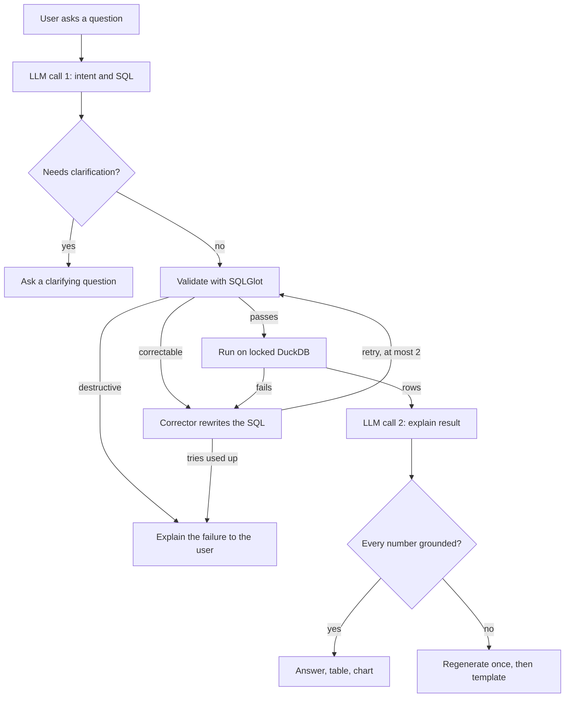

# Architecture

- Version: 1.0 (MVP design)
- Date: 2026-11-22
- Related: [PRD](prd.md), [security](security.md), [privacy](privacy.md), [ADRs](adr/README.md)

## 1. Overview

The MVP is one Python 3.12 process. A thin Streamlit UI calls one function, `ask(question, session)`, which runs a fixed pipeline and returns everything the UI shows. Only the executor runs SQL, and only the LLM client talks to OpenAI. The pipeline never imports Streamlit (ADR 0001).


## 2. Components

| Component | Module | Responsibility | Depends on |
| --- | --- | --- | --- |
| UI | `app.py`, `analyst/ui/` | Password gate, upload and overrides, preview, profile and quality tabs, chat, status, results, SQL inspector, CSV download, reset and replace, privacy notice, rate limit | Orchestrator, session store |
| Orchestrator | `analyst/pipeline/analyst.py` | Runs the pipeline, enforces budgets, maps errors to messages, records turns | All pipeline components |
| CSV loader | `analyst/ingestion/csv_loader.py` | Size check, encoding and delimiter detection, parse as text | `normalize.py` |
| Excel loader | `analyst/ingestion/excel_loader.py` | Zip-bomb check, sheet list, header detection, parse with calamine | `normalize.py` |
| Normaliser | `analyst/ingestion/normalize.py` | Type inference, day-first dates, numeric text, censored values, identifier mapping | Domain config |
| Profiler | `analyst/ingestion/profiler.py`, `schema_card.py` | Profile and quality summary computed in DuckDB; schema card text fitted to a token budget (pure function of the profile) | Session store |
| Session store | `analyst/database/session_db.py` | Per-session DuckDB, table load, lockdown, catalog, idle eviction | DuckDB |
| Executor | `analyst/database/executor.py` | Run validated SQL with timeout and row cap; classify errors | Session store |
| Context builder | `analyst/sql/context.py` | Adds sample rows, region rules and the untrusted-data block around the schema card | Profiler output |
| Generator | `analyst/sql/generator.py` | One structured call: intent, then SQL or clarification (ADR 0006) | LLM client, context |
| Validator | `analyst/sql/validator.py` | SQLGlot AST checks (ADR 0005) | Catalog |
| Corrector | `analyst/sql/corrector.py` | Category-specific repair, at most 2 attempts | LLM client, validator |
| Explainer | `analyst/pipeline/responder.py` | Plain-language answer with key numbers | LLM client |
| Grounding check | `analyst/pipeline/grounding.py` | Match every number in the answer to the result (ADR 0017) | None |
| Chart recommender | `analyst/visualization/recommender.py` | Choose chart type from result shape and intent | None |
| Chart builder | `analyst/visualization/charts.py` | Build Plotly figures | Plotly |
| Memory | `analyst/memory/conversation.py` | Turns, window of 3, carried assumptions, reset | None |
| LLM client | `analyst/llm/client.py`, `fake.py` | OpenAI structured outputs, retries, timeouts, cost (ADR 0004) | OpenAI SDK |
| Config | `analyst/config/` | Settings and limits (ADR 0014), prompts, region rules (ADR 0009) | pydantic-settings |

## 3. Session model

Each browser session holds one `AnalystSession` in `st.session_state`:

- `db`: the session's DuckDB connection (ADR 0002)
- `dataset`: metadata for the active table (original file name, sheet, column mapping, profile)
- `conversation`: the list of turns
- `settings`: region, schema-only mode
- `rate_limiter`: question timestamps
- `last_active`: for 60-minute idle eviction

Nothing user-specific is stored in module globals, `st.cache_data` or `st.cache_resource`.

## 4. Data contracts

All stages exchange Pydantic models defined in `analyst/core/models.py`. Models sent to OpenAI as structured-output schemas (marked LLM) are kept compatible with OpenAI's strict JSON schema mode, which a unit test enforces.

| Model | Kind | Key fields |
| --- | --- | --- |
| `ColumnSchema` | Internal | `sql_name`, `display_name`, `dtype`, `flags` (ambiguous_date, censored_values, mixed_types, numeric_text, all_missing, constant) |
| `ColumnProfile` | Internal | `ColumnSchema` plus `null_count`, `distinct_count`, `min_value`, `max_value`, `mean`, `std`, quartiles, `top_values`, `date_min`, `date_max` |
| `DatasetProfile` | Internal | `table_name`, `source_name`, `sheet_name`, `row_count`, `column_count`, `columns`, `duplicate_rows`, `primary_date_column`, `latest_date` |
| `QualityIssue` | Internal | `kind` (duplicate_rows, all_missing, mixed_types, censored_values, ambiguous_date, missing_values, constant), `column`, `count`, `message` |
| `Intent` | LLM | `operation`, `measures`, `dimensions`, `filters`, `time_range`, `sort`, `limit`, `output` |
| `GenerationResult` | LLM | `resolved_question`, `intent`, `assumptions`, `ambiguities`, `needs_clarification`, `clarification_question`, `sql`, `explanation`, `chart` |
| `ModelExplanation` | LLM | `answer_markdown`, `key_numbers` (value, column, label), `caveats` |
| `ValidationResult` | Internal | `status` (ok, correctable, rejected), `category`, `reason`, `safe_sql` |
| `QueryResult` | Internal | `dataframe`, `row_count`, `truncated`, `duration_ms`; successful queries only |
| `ResultSummary` | Internal | `columns`, `row_count`, `truncated`, up to 20 preview rows |
| `Turn` | Internal | `question`, `status`, `resolved_question`, `intent`, `sql`, `assumptions`, `answer_text`, `result_summary` |
| `Usage` | Internal | `llm_calls`, `input_tokens`, `output_tokens`, `cost_usd`, `latency_ms` |
| `AnalystResponse` | Internal | `status` (answered, clarification, failed), `message`, `resolved_question`, `assumptions`, `caveats`, `sql`, `result`, `chart`, `grounded`, `fallback_used`, `usage`, `turn` |

Failures are raised as typed errors from `analyst/core/errors.py`, each with a `category` for logs and a `user_message` safe to show: `IngestionError`, `QueryExecutionError`, `LLMError`, `BudgetExceededError`, `RateLimitedError`, `SessionCorruptedError`. The orchestrator turns them into a `failed` response.

## 5. Dataset loading flow

1. UI receives the uploaded bytes; size and extension are checked.
2. Excel: the zip's uncompressed size is checked, sheets are listed, the user picks one.
3. Loader parses to a dataframe of strings, detecting encoding, delimiter and header row.
4. Normaliser infers types (day-first dates by region), flags ambiguous dates and censored values, and maps names to identifiers.
5. Session store loads the dataframe with `CREATE TABLE ... AS`, then applies the lockdown settings.
6. Profiler computes the profile and quality summary in SQL; context builder renders the schema card.
7. UI shows preview, profile and quality summary; the conversation starts empty.

Uploaded bytes are never written to disk.

## 6. Question flow



Budgets per question: 2 correction attempts and 5 LLM calls in total.

## 7. Text-to-SQL details

### Context (code only)

`ContextBuilder` (`analyst/sql/context.py`) builds the intent-and-SQL call from two parts. The **system prompt** (`analyst/config/prompts.py`) is fixed text for a session: how to fill each field, the SQL rules, the region's date order and seasons (ADR 0009), how relative dates are anchored, when to ask (ADR 0011), the list of functions the validator allows, and the instruction that marked blocks are data. The **user message** has three marked blocks, in this order so the provider can cache the stable start:

- `DATASET`: the schema card, then three sample rows. The card lists, per column: SQL name, original name, type, null percentage, distinct count, min and max, date range, and up to 20 most frequent values for text columns with 50 or fewer distinct values. Target size: under 3,000 tokens. The dataset's latest date is on the card's first lines.
- `HISTORY` (omitted on the first turn): the last three turns (question, resolved question, intent, assumptions, SQL, and the clarifying question when the turn was one), then the shape of the most recent result and its first five rows.
- `QUESTION`: the user's question, at most 2,000 characters.

Schema-only mode (ADR 0010) leaves out the sample rows, the frequent values and the result preview. Cell text is cut to 80 characters and flattened to one line, and the marker lines carry a random code chosen when the builder is created, so text from the file cannot close a block (security.md, section 3). The builder returns an estimate of the prompt's tokens (3 characters per token); the generator logs it next to the real count so the estimate can be checked.

### Generation (LLM call 1)

Returns `GenerationResult` with fields in the order shown in section 4, so intent precedes SQL. Code checks every intent column exists in the catalog before validation.

### Validation (code only)

Rules are listed in [security.md](security.md#sql-validator-rules).

### Correction (LLM, bounded)

| Category | Retried | Corrector receives |
| --- | --- | --- |
| Parse error | Yes | Error position and message |
| Unknown table or column | Yes | Closest matching column names |
| Disallowed function | Yes | The function and allowed alternatives |
| Type mismatch | Yes | Column types involved |
| Other execution error | Yes | Cleaned error message |
| Timeout | Once | Request for a simpler query |
| Destructive or file access | No | Not sent |

An empty result is not an error. The answer says so and lists the filter values used.

### Execution (code only)

The validator wraps its checked SQL as `SELECT * FROM (...) LIMIT cap + 1` and records the cap in the `ValidationResult`. The executor runs only that text: it confirms on the session connection that it is exactly one `SELECT`, runs it with a timer thread that calls `connection.interrupt()` at the timeout, fetches at most cap + 1 rows (the extra row sets `truncated`), verifies the catalog after every query, and logs duration, row count and a SQL hash. The database's own error message goes to the corrector in `QueryExecutionError.engine_message` and is never logged.

### Explanation and grounding

The explainer receives question, intent, SQL, assumptions and result (all rows if 50 or fewer; otherwise the first 20 plus DuckDB-computed summary statistics). The grounding check is described in ADR 0017.

## 8. Conversational memory

- Each turn stores question, resolved question, intent, SQL, assumptions, answer and a result summary (columns, row count, up to 20 rows).
- LLM call 1 sees the last three turns (question, resolved question, intent, SQL) and only the last result summary.
- A new question always runs a new query; the explainer sees only the current result.
- Confirmed assumptions carry forward.
- Reset clears turns; replacing the dataset clears turns after confirmation.
- No persistence beyond the browser session in the MVP.

## 9. Charts

| Result shape | Chart |
| --- | --- |
| Date or timestamp column plus one or more numeric columns | Line |
| One text column (30 or fewer values) plus numeric columns | Bar |
| Two numeric columns, no grouping | Scatter |
| One numeric column of raw values | Histogram |
| Anything else, or a single value | Table only |

The model's chart suggestion is used only when its columns exist and fit the type.

## 10. Configuration

Settings come from environment variables via pydantic-settings. Names (finalised in T1.01):

| Variable | Purpose |
| --- | --- |
| `OPENAI_API_KEY` | OpenAI credential |
| `APP_PASSWORD` | Shared password for the alpha |
| `LLM_MODEL_GENERATE`, `LLM_MODEL_EXPLAIN` | Model per stage |
| `MAX_UPLOAD_MB`, `MAX_ROWS`, `MAX_COLUMNS` | Upload limits |
| `QUERY_TIMEOUT_S`, `MAX_RESULT_ROWS`, `DUCKDB_MEMORY_LIMIT`, `DUCKDB_THREADS` | Execution limits |
| `MAX_CORRECTIONS`, `MAX_LLM_CALLS` | Pipeline budgets |
| `RATE_LIMIT_QUESTIONS`, `RATE_LIMIT_WINDOW_S` | Rate limiting |
| `DEFAULT_REGION` | Region rules (default `NZ`) |
| `LOG_LEVEL`, `LOG_SQL_TEXT` | Logging |

## 11. Logging

JSON lines via the standard library. Each question logs: session hash, stage, duration, model, tokens, cost, validation category, execution category, row count, SQL hash. Full SQL text only when `LOG_SQL_TEXT=true`. Dataset values, sample rows and answer text are never logged.

## 12. Deployment

One Railway service, one replica. Start command:

```
streamlit run app.py --server.port $PORT --server.address 0.0.0.0 --server.headless true
```

Health check: `/_stcore/health`. Secrets in Railway variables. Upload limit set in `.streamlit/config.toml` (`server.maxUploadSize`). A restart clears all sessions. Details in `docs/deployment.md` (T1.20).

## 13. Evolution beyond the MVP

| Phase | Change | Where |
| --- | --- | --- |
| 2 | Column selection for wide tables, Excel and chart export, better ambiguity handling | `sql/context.py`, `ui/` |
| 3 | `analytics/` package (SciPy, Statsmodels, scikit-learn); multiple tables and joins; semantic metadata layer | New modules; catalog extended |
| 4 | `agents/` package; LangGraph evaluated by ADR | Orchestrator replaced or wrapped |
| 5 | Accounts, PostgreSQL for metadata and history, object storage, monitoring; UI framework revisited | New services |
