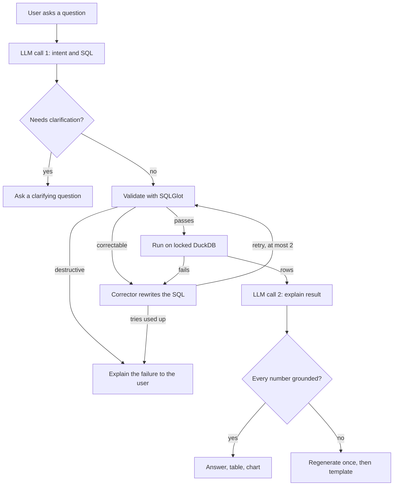

# Architecture

- Version: 1.0 (MVP design)
- Date: 2026-11-22
- Related: [PRD](prd.md), [security](security.md), [privacy](privacy.md), [ADRs](adr/README.md)

## 1. Overview

The MVP is one Python 3.12 process. A thin Streamlit UI calls one function, `ask(question, session)`, which runs a fixed pipeline and returns everything the UI shows. Only the executor runs SQL, and only the LLM client talks to OpenAI. The pipeline never imports Streamlit (ADR 0001).


## 2. Components

| Component | Module | Responsibility | Depends on |
| --- | --- | --- | --- |
| UI | `app.py`, `analyst/ui/` | Password gate, upload and overrides, preview, profile and quality tabs, chat, status, results, SQL inspector, CSV download, reset and replace, privacy notice, rate limit | Orchestrator, session store |
| Orchestrator | `analyst/pipeline/analyst.py` | Runs the pipeline, enforces budgets, maps errors to messages, records turns | All pipeline components |
| CSV loader | `analyst/ingestion/csv_loader.py` | Size check, encoding and delimiter detection, parse as text | `normalize.py` |
| Excel loader | `analyst/ingestion/excel_loader.py` | Zip-bomb check, sheet list, header detection, parse with calamine | `normalize.py` |
| Normaliser | `analyst/ingestion/normalize.py` | Type inference, day-first dates, numeric text, censored values, identifier mapping | Domain config |
| Profiler | `analyst/ingestion/profiler.py`, `schema_card.py` | Profile and quality summary computed in DuckDB; schema card text fitted to a token budget (pure function of the profile) | Session store |
| Session store | `analyst/database/session_db.py` | Per-session DuckDB, table load, lockdown, catalog, idle eviction | DuckDB |
| Executor | `analyst/database/executor.py` | Run validated SQL with timeout and row cap; classify errors | Session store |
| Context builder | `analyst/sql/context.py` | Adds sample rows, region rules and the untrusted-data block around the schema card | Profiler output |
| Generator | `analyst/sql/generator.py` | One structured call: intent, then SQL or clarification (ADR 0006) | LLM client, context |
| Validator | `analyst/sql/validator.py` | SQLGlot AST checks (ADR 0005) | Catalog |
| Corrector | `analyst/sql/corrector.py` | Category-specific repair, at most 2 attempts | LLM client, validator |
| Explainer | `analyst/pipeline/explainer.py` | Plain-language answer with key numbers | LLM client |
| Grounding check | `analyst/pipeline/grounding.py` | Match every number in the answer to the result (ADR 0017) | None |
| Chart recommender | `analyst/visualization/recommender.py` | Choose chart type from result shape and intent | None |
| Chart builder | `analyst/visualization/charts.py` | Build Plotly figures | Plotly |
| Memory | `analyst/memory/conversation.py` | Turns, window of 3, carried assumptions, reset | None |
| LLM client | `analyst/llm/client.py`, `fake.py` | OpenAI structured outputs, retries, timeouts, cost (ADR 0004) | OpenAI SDK |
| Config | `analyst/config/` | Settings and limits (ADR 0014), prompts, region rules (ADR 0009) | pydantic-settings |

## 3. Session model

Each browser session holds one `AnalystSession` in `st.session_state`:

- `db`: the session's DuckDB connection (ADR 0002)
- `dataset`: metadata for the active table (original file name, sheet, column mapping, profile)
- `conversation`: the list of turns
- `settings`: region, schema-only mode
- `rate_limiter`: question timestamps
- `last_active`: for 60-minute idle eviction

Nothing user-specific is stored in module globals, `st.cache_data` or `st.cache_resource`.

## 4. Data contracts

All stages exchange Pydantic models defined in `analyst/core/models.py`. Models sent to OpenAI as structured-output schemas (marked LLM) are kept compatible with OpenAI's strict JSON schema mode, which a unit test enforces.

| Model | Kind | Key fields |
| --- | --- | --- |
| `ColumnSchema` | Internal | `sql_name`, `display_name`, `dtype`, `flags` (ambiguous_date, censored_values, mixed_types, numeric_text, all_missing, constant) |
| `ColumnProfile` | Internal | `ColumnSchema` plus `null_count`, `distinct_count`, `min_value`, `max_value`, `mean`, `std`, quartiles, `top_values`, `date_min`, `date_max` |
| `DatasetProfile` | Internal | `table_name`, `source_name`, `sheet_name`, `row_count`, `column_count`, `columns`, `duplicate_rows`, `primary_date_column`, `latest_date` |
| `QualityIssue` | Internal | `kind` (duplicate_rows, all_missing, mixed_types, censored_values, ambiguous_date, missing_values, constant), `column`, `count`, `message` |
| `Intent` | LLM | `operation`, `measures`, `dimensions`, `filters`, `time_range`, `sort`, `limit`, `output` |
| `GenerationResult` | LLM | `resolved_question`, `intent`, `assumptions`, `ambiguities`, `needs_clarification`, `clarification_question`, `sql`, `explanation`, `chart` |
| `ModelExplanation` | LLM | `answer_markdown`, `key_numbers` (value, column, label), `caveats` |
| `ValidationResult` | Internal | `status` (ok, correctable, rejected), `category`, `reason`, `safe_sql` |
| `QueryResult` | Internal | `dataframe`, `row_count`, `truncated`, `duration_ms`; successful queries only |
| `ResultSummary` | Internal | `columns`, `row_count`, `truncated`, up to 20 preview rows |
| `Turn` | Internal | `question`, `status`, `resolved_question`, `intent`, `sql`, `assumptions`, `answer_text`, `result_summary` |
| `Usage` | Internal | `llm_calls`, `input_tokens`, `output_tokens`, `cost_usd`, `latency_ms` |
| `AnalystResponse` | Internal | `status` (answered, clarification, failed), `message`, `resolved_question`, `assumptions`, `caveats`, `sql`, `result`, `chart`, `grounded`, `fallback_used`, `usage`, `turn` |

Failures are raised as typed errors from `analyst/core/errors.py`, each with a `category` for logs and a `user_message` safe to show: `IngestionError`, `QueryExecutionError`, `LLMError`, `BudgetExceededError`, `RateLimitedError`, `SessionCorruptedError`. The orchestrator turns them into a `failed` response.

## 5. Dataset loading flow

1. UI receives the uploaded bytes; size and extension are checked.
2. Excel: the zip's uncompressed size is checked, sheets are listed, the user picks one.
3. Loader parses to a dataframe of strings, detecting encoding, delimiter and header row.
4. Normaliser infers types (day-first dates by region), flags ambiguous dates and censored values, and maps names to identifiers.
5. Session store loads the dataframe with `CREATE TABLE ... AS`, then applies the lockdown settings.
6. Profiler computes the profile and quality summary in SQL; context builder renders the schema card.
7. UI shows preview, profile and quality summary; the conversation starts empty.

Uploaded bytes are never written to disk.

## 6. Question flow



Budgets per question: 2 correction attempts and 5 LLM calls in total.

## 7. Text-to-SQL details

### Context (code only)

`ContextBuilder` (`analyst/sql/context.py`) builds the intent-and-SQL call from two parts. The **system prompt** (`analyst/config/prompts.py`) is fixed text for a session: how to fill each field, the SQL rules, the region's date order and seasons (ADR 0009), how relative dates are anchored, when to ask (ADR 0011), the list of functions the validator allows, and the instruction that marked blocks are data. The **user message** has three marked blocks, in this order so the provider can cache the stable start:

- `DATASET`: the schema card, then three sample rows. The card lists, per column: SQL name, original name, type, null percentage, distinct count, min and max, date range, and up to 20 most frequent values for text columns with 50 or fewer distinct values. Target size: under 3,000 tokens. The dataset's latest date is on the card's first lines.
- `HISTORY` (omitted on the first turn): the last three turns (question, resolved question, intent, assumptions, SQL, and the clarifying question when the turn was one), then the shape of the most recent result and its first five rows.
- `QUESTION`: the user's question, at most 2,000 characters.

Schema-only mode (ADR 0010) leaves out the sample rows, the frequent values and the result preview. Cell text is cut to 80 characters and flattened to one line, and the marker lines carry a random code chosen when the builder is created, so text from the file cannot close a block (security.md, section 3). The builder returns an estimate of the prompt's tokens (3 characters per token); the generator logs it next to the real count so the estimate can be checked.

### Generation (LLM call 1)

Returns `GenerationResult` with fields in the order shown in section 4, so intent precedes SQL. Code checks every intent column exists in the catalog before validation.

### Validation (code only)

Rules are listed in [security.md](security.md#sql-validator-rules).

### Correction (LLM, bounded)

| Category | Retried | Corrector receives |
| --- | --- | --- |
| Parse error | Yes | Error position and message |
| Unknown table or column | Yes | Closest matching column names |
| Disallowed function | Yes | The function and allowed alternatives |
| Type mismatch | Yes | Column types involved |
| Other execution error | Yes | Cleaned error message |
| Timeout | Once | Request for a simpler query |
| Destructive or file access | No | Not sent |

An empty result is not an error. The answer says so and lists the filter values used.

### Execution (code only)

The validator wraps its checked SQL as `SELECT * FROM (...) LIMIT cap + 1` and records the cap in the `ValidationResult`. The executor runs only that text: it confirms on the session connection that it is exactly one `SELECT`, runs it with a timer thread that calls `connection.interrupt()` at the timeout, fetches at most cap + 1 rows (the extra row sets `truncated`), verifies the catalog after every query, and logs duration, row count and a SQL hash. The database's own error message goes to the corrector in `QueryExecutionError.engine_message` and is never logged.

### LLM client (every model call)

`LLMClient.complete(stage, messages, response_model, budget=…)` is the only way the pipeline talks to a model (`analyst/llm/client.py`). It calls the OpenAI Responses API with structured outputs, so the caller names a Pydantic model and gets an instance back or an `LLMError`. The stage picks the model: `generate` and `correct` use `LLM_MODEL_GENERATE`, `explain` uses `LLM_MODEL_EXPLAIN`.

- **Configuration.** A missing key or model is `not_configured`, raised before any network call and before the call budget is charged. The key is a `SecretStr` and is never logged.
- **Budget.** A per-question `CallBudget` (`MAX_LLM_CALLS`) is charged once per logical call; retries inside the client do not use extra budget. The call after the last one allowed raises `BudgetExceededError` before anything is sent.
- **Retries.** Connection failures, 429 and 5xx are retried up to `LLM_MAX_RETRIES` times with exponential backoff (1 s base, 8 s cap) and jitter, honouring `Retry-After` up to 20 s; a longer wait fails at once. Other 4xx errors, a timeout, and an exhausted quota (`insufficient_quota`, which retrying cannot fix) are not retried. The SDK's own retries are off so the client is the only place that retries.
- **Privacy.** Every request sends `store=false` (ADR 0010, privacy.md). Prompts and answers are never logged.
- **Unusable answers.** A refusal, a cut-off answer (`incomplete:<reason>`), output that does not fit the model, and a 200 response with nothing in it are `invalid_output`, and are not retried by the client; the stage that knows its budget decides whether to ask again. A 200 whose body is not a Responses payload at all (a proxy error page) is `api_error`.
- **Cost.** Token counts come from the response. Cost is computed from `LLM_PRICES` (a JSON map of model name to `input_per_mtok`, `output_per_mtok` and optional `cached_input_per_mtok`, in dollars per million tokens); a model with no price costs 0 and the log line says `cost_known: false`. A call that reached the model but gave an unusable answer was still billed, so its `LLMError` carries `usage` for the orchestrator to add to the question's total.
- **Logging.** One `llm_call` line per success (stage, model, schema name, tokens including cached and reasoning, cost, latency, attempts, request id), `llm_retry` per retry, and `llm_call_failed` per failure.

`FakeLLMClient` (`analyst/llm/fake.py`) implements the same protocol from a script, so every other stage is tested without the network.

### Explanation and grounding

The explainer receives question, intent, SQL, assumptions and result. The grounding check is described in ADR 0017.

**What the model is shown** (`ContextBuilder.explanation_context`, `analyst/pipeline/result_digest.py`). Three marked blocks: `QUESTION` (the question, and its restatement if different), `ANALYSIS` (intent, assumptions, SQL) and `RESULT`. A result of 50 rows or fewer is shown in full. A longer one shows its first 20 rows and a list of statistics computed in code over all returned rows: for each column the number of values and missing values, and for numbers the minimum, maximum, mean, median and sum, for dates the earliest and latest, for text the number of distinct values and the three most common with their counts. Results are cut to their first 30 columns and the model is told how many were left out. If the query hit the row cap the model is told to say so. The statistics are numbers the model may quote, so they are passed to the grounding check as extra allowed numbers. The marked-block rules are the same as for generation (containment below and in security.md), and the result is sent in schema-only mode too, because the answer must describe it (ADR 0010).

**Explainer flow** (`analyst/pipeline/explainer.py`, `Explainer.explain`):

1. An empty result needs no model call. Code writes the answer and names the filters (`empty_result_answer`).
2. The model returns `ModelExplanation` (answer text, key numbers, caveats). Text from the model is made safe: links are reduced to their text, images are replaced by their alt text, and web and email addresses are removed (see Security below). The cleaned text is what is checked and what is shown.
3. The answer passes if `check_grounding` finds nothing wrong and the text has no spelled-out number from eleven up (`twelve`, `fifty`, `hundred`, `million` not after a digit), because the check cannot read those. Words up to ten are not looked for: they are too common in ordinary sentences, so a made-up "three" is a known gap that the prompt's request for digits narrows.
4. A failed check gets one regeneration. The model is shown its own answer and a sentence naming the numbers that were not accepted (numbers only, never values from the result). An answer that is empty, refused, cut off or does not fit the schema (`invalid_output`) also gets one more try.
5. A second failure, a failed call (timeout, API error, rate limit), or an exhausted call budget gives the template answer from code (`template_answer`) and the table. The question is not failed because the explanation was: the query ran, and its table is the answer. `Explanation.fallback_reason` records why (`ungrounded`, `llm_error`, `budget`, or `empty_result`, which is not counted as a fallback), so the benchmark can report the fallback rate.
6. Notes written by code (truncation, missing values) always come first in `caveats`, followed by the model's, without repeats.

The explainer makes at most two model calls per question, charged to the question's `CallBudget`. T1.17 must leave one call in the budget for it, or a question that needed all its calls for correction gets the template answer.

**Grounding check** (`analyst/pipeline/grounding.py`, pure code). It reads every number out of the explanation's text, caveats and key-number labels, and requires each to match a number the pipeline can vouch for: a value in the result, the result's row and column counts, a number in the question or the assumptions, the year, month and day of a date in the result, a number written inside a text value or column name, or an extra number the pipeline supplies (such as the summary statistics shown for a long result). Each key number must also be a value of the result column it names. A derived figure (a difference, ratio or share) matches nothing unless a query produced it, which is the point.

How a written number is read: `1,234.5`, `$1,234`, `12%`, `12 percent`, `.5`, `1e3`, `1.2 million` and `3k` are understood; a leading minus is ignored, so direction is not checked. A number matches if it is within half a unit of its last written digit of an allowed value (`1,234.57` and `1,235` both match 1234.5678), and `12%` matches 12 or 0.12. Trailing zeros are not treated as rounding, so `1,200` does not match 1,234; this is strict on purpose, and the benchmark's fallback rate will show whether to relax it. Not read: numbers spelled as words, ordinals, digits inside identifiers such as `Q3`, and list numbering. The explainer's prompt must ask for digits.

**Notes written by code** (`analyst/pipeline/result_notes.py`) so they cannot be wrong, and so they need no grounding check: a caveat when the result was cut at the row cap, caveats naming columns with missing values (at most five, then a count of the rest), the answer for an empty result (which lists the filters and date range from the intent), and the template answer used when no explanation passes the check (ADR 0017): "Here is the result of the query", with the single value stated when the result is one number.

## 8. Conversational memory

`ConversationMemory` (`analyst/memory/conversation.py`) is one in-process object per session.

- Each turn stores question, resolved question, intent, SQL, assumptions, answer and a result summary (columns, row count, up to 20 rows). At most 50 turns are kept; the oldest are dropped beyond that.
- `recent()` returns the last three turns. LLM call 1 sees those (question, resolved question, intent, SQL) and only the most recent result summary.
- A new question always runs a new query; the explainer sees only the current result.
- Carried assumptions: the assumptions stated on answered turns are kept for the rest of the session, oldest first, without repeats (a restated one moves to the end), at most the latest eight. A user who sees an assumption and carries on has accepted it; turns that asked for clarification or failed settle nothing and carry nothing. When two carried assumptions conflict, the later one is the one to follow, which is why the order is kept. The orchestrator (T1.17) passes them to the context builder.
- Reset clears turns and carried assumptions. Replacing the dataset does the same, after the interface has asked for confirmation.
- No persistence beyond the browser session in the MVP.

## 9. Charts

| Result shape | Chart |
| --- | --- |
| Date or timestamp column plus one or more numeric columns | Line |
| One text column (30 or fewer values) plus numeric columns | Bar |
| Two numeric columns, no grouping | Scatter |
| One numeric column of raw values | Histogram |
| Anything else, or a single value | Table only |

The model's chart suggestion is used only when its columns exist and fit the type.

## 10. Configuration

Settings come from environment variables via pydantic-settings. Names (finalised in T1.01):

| Variable | Purpose |
| --- | --- |
| `OPENAI_API_KEY` | OpenAI credential |
| `APP_PASSWORD` | Shared password for the alpha |
| `LLM_MODEL_GENERATE`, `LLM_MODEL_EXPLAIN` | Model per stage |
| `LLM_TIMEOUT_S`, `LLM_MAX_RETRIES` | Per-attempt timeout and retries for rate limits and server errors |
| `LLM_PRICES` | JSON map of model name to prices per million tokens, for cost logging |
| `MAX_UPLOAD_MB`, `MAX_ROWS`, `MAX_COLUMNS` | Upload limits |
| `QUERY_TIMEOUT_S`, `MAX_RESULT_ROWS`, `DUCKDB_MEMORY_LIMIT`, `DUCKDB_THREADS` | Execution limits |
| `MAX_CORRECTIONS`, `MAX_LLM_CALLS` | Pipeline budgets |
| `RATE_LIMIT_QUESTIONS`, `RATE_LIMIT_WINDOW_S` | Rate limiting |
| `DEFAULT_REGION` | Region rules (default `NZ`) |
| `LOG_LEVEL`, `LOG_SQL_TEXT` | Logging |

## 11. Logging

JSON lines via the standard library. Each question logs: session hash, stage, duration, model, tokens, cost, validation category, execution category, row count, SQL hash. Full SQL text only when `LOG_SQL_TEXT=true`. Dataset values, sample rows and answer text are never logged.

## 12. Deployment

One Railway service, one replica. Start command:

```
streamlit run app.py --server.port $PORT --server.address 0.0.0.0 --server.headless true
```

Health check: `/_stcore/health`. Secrets in Railway variables. Upload limit set in `.streamlit/config.toml` (`server.maxUploadSize`). A restart clears all sessions. Details in `docs/deployment.md` (T1.20).

## 13. Evolution beyond the MVP

| Phase | Change | Where |
| --- | --- | --- |
| 2 | Column selection for wide tables, Excel and chart export, better ambiguity handling | `sql/context.py`, `ui/` |
| 3 | `analytics/` package (SciPy, Statsmodels, scikit-learn); multiple tables and joins; semantic metadata layer | New modules; catalog extended |
| 4 | `agents/` package; LangGraph evaluated by ADR | Orchestrator replaced or wrapped |
| 5 | Accounts, PostgreSQL for metadata and history, object storage, monitoring; UI framework revisited | New services |
